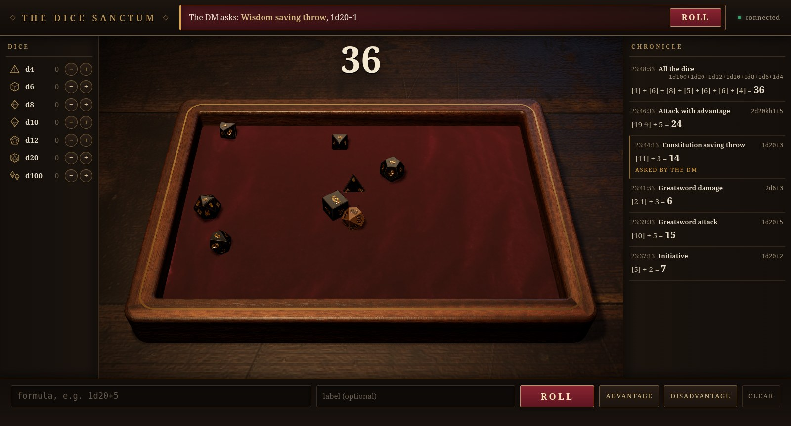

# The Dice Sanctum

Un tavolo di dadi 3D con la fisica vera, fatto per giocare di ruolo con Claude Code come master.

Si tira su un vassoio di noce, nel browser. Appena i dadi si fermano, il tiro arriva alla sessione di Claude Code che fa il DM, attraverso un piccolo ponte locale e un server MCP. Il DM può anche chiedere un tiro: sul tavolo compare l'avviso col suo pulsante TIRA, e il risultato torna nella stessa chiamata.



*In English: [README.md](README.md)*

## Come funziona

Tre pezzi, tutti sulla stessa macchina:

- **il tavolo**: una pagina (Three.js per la scena, Rapier per la fisica) aperta in una finestra del browser;
- **il ponte**: un processo Node su `127.0.0.1:4777` che serve la pagina, parla col tavolo, scrive il registro e risponde al server MCP;
- **il server MCP** `dice-sanctum`: quattro strumenti per il DM, e il canale che spinge i tiri nella sessione.

Ogni risultato esce dalla fisica: i dadi partono con rotazione e velocità a caso, rimbalzano sulle sponde, e il valore si legge dalla faccia che resta in alto. Il ponte controlla ogni tiro che riceve (formula, valori dei dadi, dadi tenuti, totale) prima di scriverlo.

## Che cosa serve

- Node.js 24 o più nuovo
- un browser con WebGL 2 (sviluppato su Chromium; su Firefox e Safari dovrebbe andare, e resta da provare)
- Claude Code, per la parte del DM (il tavolo funziona anche da solo)

Sviluppato e provato su Linux. Il comando di avvio, il ponte e il server MCP sono scritti per girare anche su macOS e Windows; lì nessuno li ha ancora provati, e le segnalazioni sono benvenute.

## Per cominciare

```sh
git clone https://github.com/andreainandri/dice-sanctum.git
cd dice-sanctum
npm install
npm start
```

`npm start` costruisce la pagina quando serve, accende il ponte in primo piano e apre il tavolo nel browser predefinito. Ctrl+C spegne il ponte. Col ponte già acceso, `npm start` apre soltanto il tavolo.

Poi, una volta sola, il server MCP in Claude Code:

```sh
claude mcp add dice-sanctum --scope user -e DICE_SANCTUM_PLAYER=IlTuoNome -- node /percorso/assoluto/di/dice-sanctum/src/mcp/server.ts
```

`DICE_SANCTUM_PLAYER` è il nome che il DM legge nei risultati («Ada rolled r-0007: …»); senza, i testi dicono «the player». I testi per il DM sono in inglese, qualunque lingua si parli al tavolo, e le istruzioni del server dicono a Claude di usarlo soltanto nella sessione del DM.

### I tiri in tempo reale

Claude Code può ricevere i tiri nel momento in cui cadono, anche a sessione ferma, coi *canali*, un'anteprima. La sessione del DM parte così:

```sh
claude --dangerously-load-development-channels server:dice-sanctum --allowedTools=mcp__dice-sanctum
```

All'avvio Claude Code avvisa dei canali in sviluppo: si sceglie «I am using this for local development». Da lì ogni tiro entra nella conversazione come un messaggio del tipo `<channel source="dice-sanctum" seq="12" kind="free" total="25">Free roll by Ada: Perception 1d20+5: [20] +5 = 25 · NATURAL 20</channel>`, e il DM risponde subito. `--allowedTools` permette al DM i quattro strumenti senza una conferma a ogni tiro.

Provato con Claude Code 2.1.325, dove i canali sono un'anteprima; l'opzione può cambiare nelle versioni dopo.

Senza canali il DM riceve lo stesso ogni tiro che chiede, perché `request_player_roll` restituisce il risultato. Per i tiri liberi può tenere il Monitor sul registro:

```sh
tail -n0 -F ~/.local/share/dice-sanctum/tiri.jsonl | grep --line-buffered '"type":"roll.completed"'
```

(su macOS e Windows il registro sta altrove: vedi [Configurazione](#configurazione)), e chiamare `get_rolls` con l'ultimo seq visto ogni volta che riarma il Monitor.

## Al tavolo

- **Il pannello dei dadi** a sinistra: un clic sul nome di un dado ne aggiunge uno, `+` e `−` cambiano il numero. Il campo della formula segue il pannello, e il pannello segue il campo.
- **La formula**: `1d20+5`, `2d20kh1+5`, `4d6kh3`, `8d6`, `1d100`, `2d6+1d4-1`. Al più 30 dadi fisici per tiro (un d100 conta due dadi). L'etichetta, facoltativa, dice che cosa si tira.
- **TIRA**, **Invio** nel campo o **Spazio** fuori dai campi: tira. **VANTAGGIO** e **SVANTAGGIO** tirano due d20 e tengono il più alto o il più basso, lasciando il campo com'è. **PULISCI** toglie i dadi dal vassoio e svuota i campi; la cronaca resta.
- **Il risultato** grande sopra il vassoio: il 20 naturale in oro, col dado che si accende per un momento, e l'1 naturale in rosso.
- **La cronaca** a destra: ora, etichetta, formula, dadi (gli scartati attenuati), totale, e «chiesto dal DM» sui tiri delle richieste. Si riempie dal registro a ogni apertura della pagina.
- **L'avviso del DM** in alto: «Il DM chiede: **Salvezza su Costituzione**, 1d20+3» col suo TIRA, che lancia esattamente quella formula con quell'etichetta. Con più richieste, la più vecchia sta in cima.
- **Lo stato del collegamento** in alto a destra. I tiri fatti da scollegati aspettano in coda, tenuta nella memoria del browser e quindi anche a finestra chiusa, e partono da soli appena il ponte risponde, ciascuno una volta.

La pagina parla italiano o inglese, secondo la lingua del browser; `?lingua=it` o `?lingua=en` nell'indirizzo ne sceglie una. Si adatta alla finestra: sotto i 900 pixel di larghezza i dadi passano in una fascia sotto il vassoio e la cronaca si apre da un pulsante.

### Come si scrivono i dadi

| si scrive | vuol dire |
|---|---|
| `NdS` | N dadi da S facce: d4, d6, d8, d10, d12, d20, d100 (anche `d%`) |
| `khN`, `klN` | tiene gli N più alti o più bassi del gruppo: `2d20kh1` è il vantaggio |
| `dhN`, `dlN` | scarta gli N più alti o più bassi: `4d6dl1` |
| `+`, `-`, numeri | gruppi e costanti si sommano o si sottraggono: `1d8+1d6+3`, `1d20-1` |

Il d100 è due d10, decine e unità, e 00 con 0 fa 100. Il naturale vale quando la formula tiene un solo d20, in un gruppo che si somma: `1d20+5` e `2d20kh1+5` sì, `2d20+3` no.

## Per il DM

Le stesse cose, in breve, stanno nelle istruzioni del server MCP, che Claude Code mette nel contesto della sessione.

| strumento | argomenti | risponde |
|---|---|---|
| `get_status` | nessuno | ponte acceso o spento, tavoli collegati, ultimo seq, richieste aperte (la più vecchia per prima) |
| `get_rolls` | `since_seq?`, `limit?` (da 1 a 500) | gli eventi dopo `since_seq`, uno per riga col suo seq; senza argomenti gli ultimi 10 |
| `request_player_roll` | `formula`, `label`, `wait_seconds?` (da 0 a 110) | il tiro, oppure «Waiting»; un errore chiaro se il tavolo non è aperto o il ponte è spento |
| `cancel_player_roll` | `requestId` | annullata; se era già tirata, il tiro |

- **Un tiro del personaggio** (un attacco, i danni, una salvezza, una prova che il giocatore vede): `request_player_roll` con `wait_seconds` fino a 110. La chiamata risponde col tiro: «Ada rolled r-0007: Constitution saving throw 1d20+3: [14] +3 = 17 (seq 42).» Mentre aspetta, la sessione è ferma su quella chiamata, e quello che il giocatore scrive in chat resta in coda finché la chiamata non torna. Per chiedere un tiro e intanto continuare a raccontare, `wait_seconds` 0.
- **Se il tempo scade** prima del tiro, la risposta è «Waiting: …». La richiesta resta sul tavolo, e il tiro arriva dal canale quando cade.
- **I tiri liberi**, quelli coi controlli normali, arrivano dal canale appena i dadi si fermano. Ogni tiro arriva al DM una volta sola: un tiro restituito da una chiamata resta fuori dal canale.
- **Un tiro libero non soddisfa mai una richiesta**, anche con la stessa formula. Se il giocatore vuole tirare altro, il DM annulla con `cancel_player_roll` e chiede di nuovo.
- **Dopo un'interruzione**, `get_rolls(since_seq)` restituisce tutto quello che è entrato nel registro nel frattempo.

Perché 110 secondi: Claude Code manda in sottofondo una chiamata MCP che dura più di 120 secondi (`CLAUDE_CODE_MCP_AUTO_BACKGROUND_MS`). Con 110 la risposta torna sempre nella conversazione.

## Configurazione

Variabili d'ambiente, tutte facoltative:

| variabile | chi la legge | se manca |
|---|---|---|
| `DICE_SANCTUM_PORT` | il ponte, `npm start` | `4777` |
| `DICE_SANCTUM_ROLL_LOG` | il ponte | `tiri.jsonl` nella cartella dei dati |
| `DICE_SANCTUM_CLIENT_DIR` | il ponte | `dist/client` nel progetto |
| `DICE_SANCTUM_URL` | il server MCP | `http://127.0.0.1:4777` |
| `DICE_SANCTUM_PLAYER` | il server MCP | `the player` |

La cartella dei dati è `$XDG_DATA_HOME/dice-sanctum` (o `~/.local/share/dice-sanctum`) su Linux, `~/Library/Application Support/dice-sanctum` su macOS e `%APPDATA%\dice-sanctum` su Windows.

Il registro è un file JSONL che cresce soltanto: una riga JSON compatta per evento (`request.created`, `roll.completed`, `request.cancelled`), ciascuna su disco (fsync) prima che qualcuno la veda. Il `seq` lo assegna soltanto il ponte. Al riavvio il ponte rilegge il file e ricostruisce l'ultimo seq, i tiri già visti e le richieste aperte.

## Sicurezza

Il ponte è fatto per una persona su una macchina, e non ha token. Lo proteggono queste cose:

- ascolta soltanto su `127.0.0.1`, e risponde soltanto a `Host: 127.0.0.1:PORTA` o `localhost:PORTA`, contro il DNS rebinding;
- il WebSocket del tavolo accetta soltanto l'origine dell'app; il feed del server MCP accetta i processi (che non mandano Origin) e l'origine dell'app, e respinge le pagine web;
- l'API HTTP vuole `Content-Type: application/json` e respinge ogni altro Origin e i corpi oltre i 64 KB, così una pagina web aperta nel browser non può creare richieste di tiro;
- al più 30 dadi per tiro; nessun `eval`, e niente di quello che arriva viene mai eseguito come comando;
- il ponte rifà il conto di ogni tiro dai valori dei dadi e respinge quello che non torna.

Un programma che gira col tuo utente può comunque parlare col ponte: la fiducia arriva fin lì.

## Equità

Lanci simulati con la stessa fisica, la stessa fonte del caso (`crypto.getRandomValues`) e la stessa lettura delle facce del tavolo: 20.000 dadi per prova, ogni tipo da solo e a gruppi di cinque, confrontati col chi quadro con la distribuzione uniforme. Nessun dado mostra segni di bias; il p più basso fra tutte le prove è 0,082. Il resoconto completo è in [docs/equita.md](docs/equita.md), e `npm run fairness` lo rifà.

Un bias trovato e tolto per strada. Rapier costruisce il contatto di una faccia con al più quattro punti, quindi sui pentagoni del d12 un vertice restava fuori e il dado usciva sbilanciato (p sotto 0,001 in due prove separate). Adesso il d12 è un cubo con sei tetti, la costruzione di Euclide, e fondo e sponde del vassoio sono piani per lo stesso motivo.

## Le scelte

- **La gravità è 650 cm/s²**, un terzo meno di quella vera: un rallentatore di circa il 23%, che dà ai dadi il peso di oggetti visti da vicino. Un dado da solo rotola fra 0,6 e 0,9 secondi, il tavolo pieno di trenta dadi circa 1,5.
- **Al più due ritiri per dado.** Un dado fermo storto (oltre 6° dalla faccia piana), uscito dal vassoio o ancora in moto dopo 6 secondi ricade dall'alto sopra il punto più libero. Se gli servirebbe il terzo, il tiro si annulla e il tavolo ne chiede uno nuovo; il registro non ne sa niente. È successo in 5 tavoli pieni su 800 e in 1 lancio di 5d12 su 4.000, e mai in 20.000 lanci di un dado solo.
- **Il 6 e il 9 sono sottolineati** quando stanno da soli su una faccia.
- **A parità di valore, fra i dadi tenuti vince il primo tirato** (kh, kl, dh, dl).
- **La camera è fissa**, inclinata di 40° dalla verticale, alla distanza minima che tiene tutto il vassoio nel riquadro; nelle finestre strette e alte guarda dal lato corto del vassoio.
- **Le trame** di noce, velluto e tavolo sono foto generate con FLUX (Black Forest Labs) e preparate per la scena: tolta la luce cotta nella foto, ricavati rilievo e ruvidezza. Caratteri e trame stanno nel progetto, e la pagina gira anche senza rete.

## Sviluppo

```sh
npm test            # 130 prove: notazione, geometrie, fisica, eventi, ponte, server MCP
npm run typecheck
npm run build       # la pagina in dist/client
npm run dev         # la pagina dal codice su 127.0.0.1:4778, senza ponte
npm run bridge      # il ponte in primo piano, senza aprire il browser
npm run fairness    # le prove di equità (qualche minuto); riscrive docs/equita.md
```

Il codice è TypeScript che Node esegue direttamente (type stripping), coi commenti in italiano. Il bozzetto `src/client/bozzetto.html`, servito soltanto da `npm run dev`, mostra un tavolo fermo da un seme fisso, per gli scatti: per esempio `bozzetto.html?lingua=it&naturale=20`.

Le prove d'integrazione accendono un ponte su una porta libera con un registro temporaneo, usano un WebSocket di prova al posto del browser e il client dell'SDK MCP al posto di Claude Code, e lanciano il server MCP vero come lo lancia Claude Code.

## Licenza

MIT: vedi [LICENSE](LICENSE). Il carattere Noto Serif è sotto la SIL Open Font License 1.1 (`src/client/caratteri/OFL.txt`). Le trame sono state generate per questo progetto e sono rilasciate con la licenza MIT insieme al codice.

Ideato da Andrea Inandri e scritto con Claude Code.
