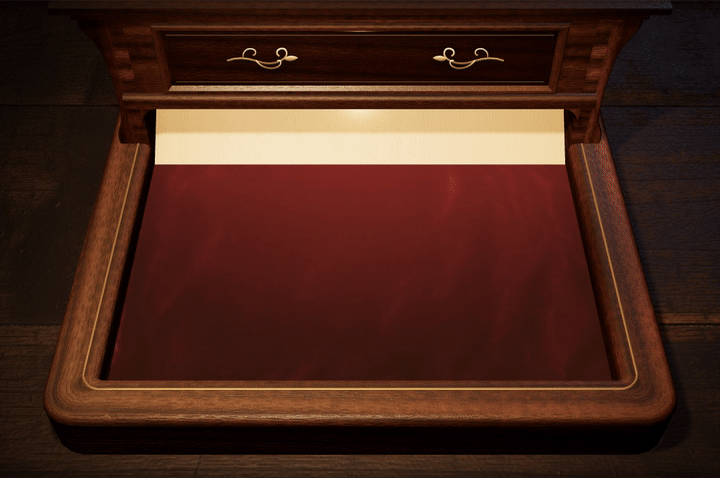
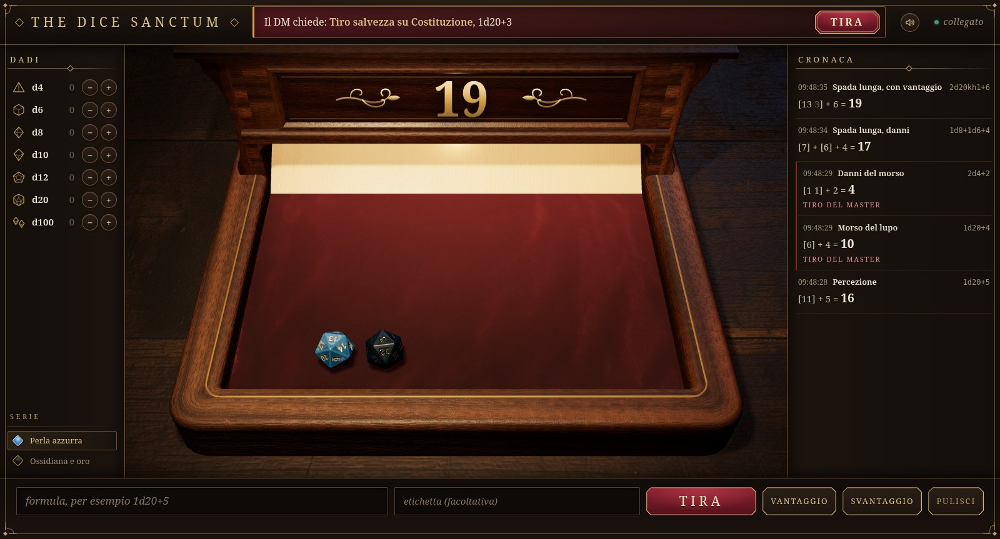
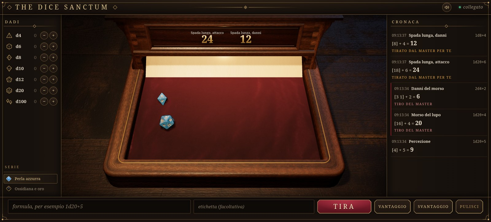

# The Dice Sanctum

Un tavolo di dadi 3D con la fisica vera, fatto per giocare di ruolo con Claude Code come master.

Si tira nel browser, in una torre dei dadi di noce: i dadi scendono fra gli scivoli, escono dall'arco e rotolano sul velluto, e ogni urto si sente. Appena si fermano, il tiro arriva alla sessione di Claude Code che fa il DM, attraverso un piccolo ponte locale e un server MCP. Il DM può anche chiedere un tiro: sul tavolo compare l'avviso col suo pulsante TIRA, e il risultato torna nella stessa chiamata. Anche i dadi del master (mostri, compagni) cadono sullo stesso vassoio, in una serie loro, e si guardano fermarsi. E quando non puoi stare al tavolo, puoi dire al master di tirare per te: rotolano lo stesso i tuoi dadi, e nel registro il tiro resta tuo.





*In English: [README.md](README.md)*

## Come funziona

Tre pezzi, tutti sulla stessa macchina:

- **il tavolo**: una pagina (Three.js per la scena, Rapier per la fisica) aperta in una finestra del browser;
- **il ponte**: un processo Node su `127.0.0.1:4777` che serve la pagina, parla col tavolo, scrive il registro e risponde al server MCP;
- **il server MCP** `dice-sanctum`: sei strumenti per il DM, e il canale che spinge i tiri nella sessione.

Ogni risultato esce dalla fisica: i dadi cadono nella torre con rotazione e velocità a caso, scendono da uno scivolo all'altro, escono dall'arco a rotolare nella corte, e il valore si legge dalla faccia che resta in alto. Il ponte controlla ogni tiro che riceve (formula, valori dei dadi, dadi tenuti, totale) prima di scriverlo.

I dadi del master li tira il ponte, con la stessa fisica e la stessa fonte del caso, in un vassoio suo. Il ponte legge le facce, scrive il tiro nel registro e manda al tavolo la ripresa del lancio: il tavolo la mostra coi dadi del master, che si fermano sulle facce scritte nel registro. I tiri che il master fa al posto tuo si tirano allo stesso modo, e si vedono coi tuoi dadi.

## Che cosa serve

- Node.js 24 o più nuovo
- un browser con WebGL 2 (sviluppato su Chromium; su Firefox e Safari dovrebbe andare, e resta da provare)
- Claude Code, per la parte del DM (il tavolo funziona anche da solo)

Sviluppato e provato su Linux. Il comando di avvio, il ponte e il server MCP sono scritti per girare anche su macOS e Windows; lì nessuno li ha ancora provati, e le segnalazioni sono benvenute.

## Per cominciare

### Come plugin di Claude Code

In una sessione di Claude Code:

```
/plugin install dice-sanctum --marketplace andreainandri/dice-sanctum
```

Serve Claude Code 2.1.275 o più nuovo. Con una versione più vecchia sono due passi: `/plugin marketplace add andreainandri/dice-sanctum`, poi `/plugin install dice-sanctum@dice-sanctum`.

Il plugin porta in una sola installazione il server MCP, il canale dei tiri e due skill. L'installazione chiede il nome di chi gioca, quello che il DM legge nei risultati («Ada rolled r-0007: …»); lasciato vuoto, i testi dicono «the player». Le dipendenze di Node del plugin le installa Claude Code.

Poi basta chiedere a Claude di aprire il tavolo dei dadi, o scrivere `/dice-sanctum:table`: accende il ponte, costruisce la pagina la prima volta e apre il tavolo nel browser predefinito. `/dice-sanctum:dm` dice a Claude come si fa il master col tavolo, e Claude lo carica da sé quando la sessione è una partita.

Un ponte acceso così si spegne quando la sessione di Claude Code si chiude. I tiri restano nel registro, e il tavolo si riapre allo stesso modo.

### A mano, dal codice

```sh
git clone https://github.com/andreainandri/dice-sanctum.git
cd dice-sanctum
npm install
npm start
```

`npm start` costruisce la pagina quando serve, accende il ponte in primo piano e apre il tavolo nel browser predefinito. Ctrl+C spegne il ponte. Col ponte già acceso, `npm start` apre soltanto il tavolo.

Poi, una volta sola, il server MCP in Claude Code (chi ha installato il plugin ce l'ha già):

```sh
claude mcp add dice-sanctum --scope user -e DICE_SANCTUM_PLAYER=IlTuoNome -- node /percorso/assoluto/di/dice-sanctum/src/mcp/server.ts
```

`DICE_SANCTUM_PLAYER` è il nome che il DM legge nei risultati; senza, i testi dicono «the player». I testi per il DM sono in inglese, qualunque lingua si parli al tavolo, e le istruzioni del server dicono a Claude di usarlo soltanto nella sessione del DM.

### I tiri in tempo reale

Claude Code può ricevere i tiri nel momento in cui cadono, anche a sessione ferma, coi *canali*, un'anteprima. Col plugin la sessione del DM parte così:

```sh
claude --dangerously-load-development-channels plugin:dice-sanctum@dice-sanctum --allowedTools=mcp__plugin_dice-sanctum_table
```

e col server registrato a mano così:

```sh
claude --dangerously-load-development-channels server:dice-sanctum --allowedTools=mcp__dice-sanctum
```

All'avvio Claude Code avvisa dei canali in sviluppo: si sceglie «I am using this for local development». Da lì ogni tiro entra nella conversazione come un messaggio del tipo `<channel source="dice-sanctum" seq="12" kind="free" total="25">Free roll by Ada: Perception 1d20+5: [20] +5 = 25 · NATURAL 20</channel>`, e il DM risponde subito. `--allowedTools` permette al DM i cinque strumenti senza una conferma a ogni tiro.

Provato con Claude Code 2.1.325 nella forma `server:`. La forma `plugin:` è quella che la documentazione dei canali indica per un plugin fuori dall'elenco approvato, e con questo plugin resta da provare. I canali sono un'anteprima: l'opzione può cambiare nelle versioni dopo.

Senza canali il DM riceve lo stesso ogni tiro che chiede, perché `request_player_roll` restituisce il risultato. Per i tiri liberi può tenere il Monitor sul registro:

```sh
tail -n0 -F ~/.local/share/dice-sanctum/tiri.jsonl | grep --line-buffered '"type":"roll.completed"' | grep --line-buffered -v '"rolledBy":"dm"'
```

(su macOS e Windows il registro sta altrove: vedi [Configurazione](#configurazione)), e chiamare `get_rolls` con l'ultimo seq visto ogni volta che riarma il Monitor.

## Al tavolo

- **Il pannello dei dadi** a sinistra: un clic sul nome di un dado ne aggiunge uno, `+` e `−` cambiano il numero. Il campo della formula segue il pannello, e il pannello segue il campo.
- **La formula**: `1d20+5`, `2d20kh1+5`, `4d6kh3`, `8d6`, `1d100`, `2d6+1d4-1`. Al più 30 dadi fisici per tiro (un d100 conta due dadi). L'etichetta, facoltativa, dice che cosa si tira.
- **TIRA**, **Invio** nel campo o **Spazio** fuori dai campi: tira. **VANTAGGIO** e **SVANTAGGIO** tirano due d20 e tengono il più alto o il più basso, lasciando il campo com'è. **PULISCI** sgombra il tavolo: i dadi dal vassoio, il totale dalla targa, i campi e la cronaca. Dimentica soltanto la pagina: il registro tiene ogni tiro per il DM, e i tiri che aspettano ancora di arrivare al ponte restano in cronaca.
- **Il risultato** sulla targa della torre, in cifre d'oro: il 20 naturale più acceso, col dado che si illumina per un momento, e l'1 naturale in rosso.
- **La cronaca** a destra: ora, etichetta, formula, dadi (gli scartati attenuati), totale, e «chiesto dal DM» sui tiri delle richieste. Si riempie dal registro a ogni apertura della pagina, dall'ultimo PULISCI in poi.
- **L'avviso del DM** in alto: «Il DM chiede: **Salvezza su Costituzione**, 1d20+3» col suo TIRA, che lancia esattamente quella formula con quell'etichetta. Con più richieste, la più vecchia sta in cima.
- **I dadi del master**: quando il master tira in chiaro, i suoi dadi, sangue di bue marmorizzato coi numeri d'oro, escono dalla stessa torre e rotolano sul vassoio, con una riga che dice chi tira che cosa. A dadi fermi ogni tiro compare sulla targa con la sua etichetta e il suo totale, ed entra nella cronaca segnato «tiro del master». Il tiro di chi gioca non viene mai interrotto: il lancio del master aspetta che i dadi si fermino e lascia il tempo di leggerli. Quando il master tira dietro lo schermo, i dadi si sentono attutiti e la cronaca dice soltanto che ha tirato, senza etichetta, dadi o totale.
- **Le serie di dadi**, in fondo al pannello: Perla azzurra (resina azzurra a nuvole, numeri d'argento) e Ossidiana e oro. La scelta resta da una visita all'altra. La serie del master è una sola e non si sceglie: a colpo d'occhio si sa di chi è il tiro.
- **Il suono**: ogni urto dei dadi si sente, diverso sul velluto, sul legno e fra dado e dado, e chiuso finché i dadi sono dentro la torre. Il pulsante in alto a destra lo spegne e lo riaccende, e la scelta resta. Il browser lascia suonare una pagina soltanto dopo il primo clic o tasto.
- **Lo stato del collegamento** in alto a destra. I tiri fatti da scollegati aspettano in coda, tenuta nella memoria del browser e quindi anche a finestra chiusa, e partono da soli appena il ponte risponde, ciascuno una volta.
- **I tiri che il master fa per te**, quando gli hai detto che non puoi stare al tavolo: dalla torre escono i tuoi dadi, con una riga che dice «Il master tira per te», il totale va sulla targa come per i tuoi tiri, e la cronaca li segna «tirato dal master per te».



La pagina parla italiano o inglese, secondo la lingua del browser; `?lingua=it` o `?lingua=en` nell'indirizzo ne sceglie una. Si adatta alla finestra: sotto i 900 pixel di larghezza i dadi e la scelta della serie passano in una fascia sotto il vassoio e la cronaca si apre da un pulsante; nelle finestre alte e strette la torre si vede intera.

### Come si scrivono i dadi

| si scrive | vuol dire |
|---|---|
| `NdS` | N dadi da S facce: d4, d6, d8, d10, d12, d20, d100 (anche `d%`) |
| `khN`, `klN` | tiene gli N più alti o più bassi del gruppo: `2d20kh1` è il vantaggio |
| `dhN`, `dlN` | scarta gli N più alti o più bassi: `4d6dl1` |
| `+`, `-`, numeri | gruppi e costanti si sommano o si sottraggono: `1d8+1d6+3`, `1d20-1` |

Il d100 è due d10, decine e unità, e 00 con 0 fa 100. Il naturale vale quando la formula tiene un solo d20, in un gruppo che si somma: `1d20+5` e `2d20kh1+5` sì, `2d20+3` no.

## Per il DM

Le stesse cose, in breve, stanno nelle istruzioni del server MCP, che Claude Code mette nel contesto della sessione, e per esteso nella skill `/dice-sanctum:dm` del plugin.

| strumento | argomenti | risponde |
|---|---|---|
| `get_status` | nessuno | ponte acceso o spento, tavoli collegati, ultimo seq, richieste aperte (la più vecchia per prima) |
| `get_rolls` | `since_seq?`, `limit?` (da 1 a 500) | gli eventi dopo `since_seq`, uno per riga col suo seq; senza argomenti gli ultimi 10 |
| `request_player_roll` | `formula`, `label`, `wait_seconds?` (da 0 a 110) | il tiro, oppure «Waiting»; un errore chiaro se il tavolo non è aperto o il ponte è spento |
| `cancel_player_roll` | `requestId` | annullata; se era già tirata, il tiro |
| `dm_roll` | `rolls` (da 1 a 8, ciascuno con `formula` e `label`), `secret?` | ogni tiro col suo seq, e dove è caduto il lancio: sul tavolo, dietro lo schermo, o senza tavolo collegato |
| `roll_for_player` | `rolls` (da 1 a 8, ciascuno con `formula` e `label`) | ogni tiro col suo seq, se un tavolo ha mostrato il lancio, e le richieste rimaste aperte |

- **Un tiro del personaggio** (un attacco, i danni, una salvezza, una prova che il giocatore vede): `request_player_roll` con `wait_seconds` fino a 110. La chiamata risponde col tiro: «Ada rolled r-0007: Constitution saving throw 1d20+3: [14] +3 = 17 (seq 42).» Mentre aspetta, la sessione è ferma su quella chiamata, e quello che il giocatore scrive in chat resta in coda finché la chiamata non torna. Per chiedere un tiro e intanto continuare a raccontare, `wait_seconds` 0.
- **Se il tempo scade** prima del tiro, la risposta è «Waiting: …». La richiesta resta sul tavolo, e il tiro arriva dal canale quando cade.
- **I tiri liberi**, quelli coi controlli normali, arrivano dal canale appena i dadi si fermano. Ogni tiro arriva al DM una volta sola: un tiro restituito da una chiamata resta fuori dal canale.
- **Un tiro libero non soddisfa mai una richiesta**, anche con la stessa formula. Se il giocatore vuole tirare altro, il DM annulla con `cancel_player_roll` e chiede di nuovo.
- **I dadi del master** (mostri, compagni, prove nascoste): `dm_roll`. I tiri di un turno vanno in una chiamata sola, attacco e danni insieme: cadono in un unico lancio di al più 30 dadi, e nella risposta ognuno ha la sua riga. In chiaro la chiamata torna quando i dadi si sono fermati sul tavolo di chi gioca, un secondo o due dopo; con `secret: true`, o senza tavolo aperto, torna subito e lo dice.
- **`dm_roll` non tira mai i dadi di chi gioca e non soddisfa mai una richiesta.** I tiri del master tornano nella loro chiamata e restano fuori dal canale; `get_rolls` li elenca con tutto il resto.
- **Quando chi gioca non può stare al tavolo** e dice al master di tirare per lui: `roll_for_player`. Il ponte tira i dadi del personaggio con la stessa fisica, e ogni tiro entra nel registro come tiro di chi gioca, con `"rolledBy":"dm"`. Un tavolo collegato mostra il lancio coi dadi di chi gioca, mette il totale sulla targa dove vanno i suoi tiri, e in cronaca segna il tiro come tirato dal master per lui; senza tavolo aperto il tiro si fa e si registra lo stesso. Questi tiri tornano nella loro chiamata e restano fuori dal canale, e non soddisfano nessuna richiesta: una richiesta aperta resta sul tavolo finché il master non la annulla. Il master usa questo strumento soltanto sulla parola di chi gioca, per un tiro o finché non torna.
- **Tornando a un tavolo rimasto nascosto**, chi gioca trova l'ultimo lancio fermo sul velluto col suo totale, e il resto in cronaca: un lancio che aspetta da più di 15 secondi di essere mostrato non si rivede rotolare.
- **Dopo un'interruzione**, `get_rolls(since_seq)` restituisce tutto quello che è entrato nel registro nel frattempo.

Perché 110 secondi: Claude Code manda in sottofondo una chiamata MCP che dura più di 120 secondi (`CLAUDE_CODE_MCP_AUTO_BACKGROUND_MS`). Con 110 la risposta torna sempre nella conversazione.

## Configurazione

Variabili d'ambiente, tutte facoltative:

| variabile | chi la legge | se manca |
|---|---|---|
| `DICE_SANCTUM_PORT` | il ponte, `npm start` | `4777` |
| `DICE_SANCTUM_ROLL_LOG` | il ponte | `tiri.jsonl` nella cartella dei dati |
| `DICE_SANCTUM_CLIENT_DIR` | il ponte | `dist/client` nel progetto |
| `DICE_SANCTUM_URL` | il server MCP | `http://127.0.0.1:4777` |
| `DICE_SANCTUM_PLAYER` | il server MCP | `the player` |

La cartella dei dati è `$XDG_DATA_HOME/dice-sanctum` (o `~/.local/share/dice-sanctum`) su Linux, `~/Library/Application Support/dice-sanctum` su macOS e `%APPDATA%\dice-sanctum` su Windows.

Il registro è un file JSONL che cresce soltanto: una riga JSON compatta per evento (`request.created`, `roll.completed`, `request.cancelled`, `dm.roll.completed`), ciascuna su disco (fsync) prima che qualcuno la veda. Un `roll.completed` che il master ha fatto al posto di chi gioca porta `rolledBy: "dm"`, col `throwId` del suo lancio e `shown`. Il `seq` lo assegna soltanto il ponte. Al riavvio il ponte rilegge il file e ricostruisce l'ultimo seq, i tiri già visti e le richieste aperte.

## Sicurezza

Il ponte è fatto per una persona su una macchina, e non ha token. Lo proteggono queste cose:

- ascolta soltanto su `127.0.0.1`, e risponde soltanto a `Host: 127.0.0.1:PORTA` o `localhost:PORTA`, contro il DNS rebinding;
- il WebSocket del tavolo accetta soltanto l'origine dell'app; il feed del server MCP accetta i processi (che non mandano Origin) e l'origine dell'app, e respinge le pagine web;
- l'API HTTP vuole `Content-Type: application/json` e respinge ogni altro Origin e i corpi oltre i 64 KB, così una pagina web aperta nel browser non può creare richieste di tiro;
- al più 30 dadi per tiro; nessun `eval`, e niente di quello che arriva viene mai eseguito come comando;
- il ponte rifà il conto di ogni tiro dai valori dei dadi e respinge quello che non torna.

Un programma che gira col tuo utente può comunque parlare col ponte: la fiducia arriva fin lì.

Lo schermo del master è di cartone. Un tiro segreto alla pagina non arriva mai, ma il registro lo tiene per intero e `GET /api/eventi` lo restituisce: lo schermo ripara dal vedere per caso, e chi vuole guardarci dietro può.

## Equità

L'equità è esatta prima ancora di essere misurata. A ogni lancio i numeri si legano al solido della fisica con una sua rotazione di simmetria tirata a sorte (60 per d12 e d20, 24 per d6 e d8, 12 per il d4, 10 per il d10): qualunque faccia il motore favorisca, porta un numero a caso, e ogni numero esce con la stessa probabilità.

Le prove controllano che il codice lo faccia davvero: lanci simulati con la stessa fisica, la stessa fonte del caso (`crypto.getRandomValues`) e la stessa lettura delle facce del tavolo, 20.000 dadi per prova, ogni tipo da solo e a gruppi di cinque, confrontati col chi quadro con la distribuzione uniforme. Una prova che esce con p sotto 0,01 si rifà da sola su cinque volte i lanci. Nessun dado mostra segni di bias; il p più basso fra tutte le prove è 0,032. Il resoconto completo è in [docs/equita.md](docs/equita.md), e `npm run fairness` lo rifà.

Due bias trovati e tolti per strada. Il primo: Rapier costruisce il contatto di una faccia con al più quattro punti, quindi sui pentagoni del d12 un vertice restava fuori e il dado usciva sbilanciato (p sotto 0,001 in due prove separate). Adesso il d12 è un cubo con sei tetti, la costruzione di Euclide, e fondo e sponde del vassoio sono piani per lo stesso motivo. Il secondo, più piccolo, si vedeva soltanto contando 100.000 lanci: il d12 ancora fuori fino al 3% (p 0,0004), perché il solutore tratta i pezzi del collisore in un ordine fisso. Da lì viene il giro a sorte, che vale per ogni dado: rifatta la conta, p 0,71.

## Le scelte

- **La gravità è quella vera**, 981 cm/s², e i dadi sono grandi (il d6 fa 19 mm): cadono e battono col loro peso. Il tiro lo allunga la torre, con quattro scivoli prima dell'arco: un dado da solo si ferma in 1,2-1,6 secondi, di cui 0,7 dentro la torre, e il tavolo pieno di trenta dadi in meno di 3.
- **La torre è larga quanto il vassoio**, 30 cm, e l'arco d'uscita quanto lei: i dadi escono già sparsi. Con una torre a scatola in un angolo, e un arco di 8,5 cm, trenta dadi facevano calca davanti all'uscita e 94 tiri su 100 fallivano.
- **Al più tre ritiri per dado.** Un dado fermo storto (oltre 6° dalla faccia piana), rimasto nella torre, uscito dal vassoio o ancora in moto dopo 6 secondi torna nella bocca della torre. Se gli servirebbe il quarto, il tiro si annulla e il tavolo ne chiede uno nuovo; il registro non ne sa niente. Nelle prove di equità non è successo mai: 800 tavoli pieni e 164.000 lanci più piccoli.
- **Il 6 e il 9 sono sottolineati** quando stanno da soli su una faccia.
- **A parità di valore, fra i dadi tenuti vince il primo tirato** (kh, kl, dh, dl).
- **I dadi del master li tira il ponte**, e il tavolo mostra la ripresa del lancio: la posizione di ogni dado, sessanta volte al secondo. Rilanciarli nella pagina da un seme peserebbe meno, ma la più piccola differenza fra Node e il browser lascerebbe sul vassoio una faccia diversa dal numero del registro.
- **La camera è fissa**, inclinata di 40° dalla verticale, dalla parte di chi tira, alla distanza minima che tiene nel riquadro la corte e la facciata della torre fino alla targa del totale. Nelle finestre larghe il resto della torre sale oltre il riquadro; in quelle strette e alte si vede intera.
- **Il totale è testo della pagina**, posato sulla targa: la scena dice al foglio di stile dove cade la targa sulla tela, a ogni misura di finestra.
- **Il suono è sintetizzato**, senza campioni registrati. Gli urti si ricavano dal moto dei dadi (un cambio brusco di velocità oltre a quello della gravità), quindi valgono allo stesso modo per un lancio simulato nella pagina e per la ripresa di un lancio del master. Un compressore e un limite morbido in uscita tengono trenta dadi sotto la saturazione.
- **Le vene dei dadi** vengono da un rumore nello spazio, letto nel punto del dado che sta sotto ogni pixel della faccia: passano da una faccia all'altra senza interrompersi, come in un dado colato davvero. Le tele si dipingono all'avvio, senza immagini.
- **Le trame** di noce, velluto e tavolo sono foto generate con FLUX (Black Forest Labs) e preparate per la scena: tolta la luce cotta nella foto, ricavati rilievo e ruvidezza. Caratteri e trame stanno nel progetto, e la pagina gira anche senza rete.

## Sviluppo

```sh
npm test            # 199 prove: notazione, geometrie, fisica, ripresa, urti, eventi, ponte, dadi del master, server MCP, plugin
npm run typecheck
npm run build       # la pagina in dist/client
npm run dev         # la pagina dal codice su 127.0.0.1:4778, senza ponte
npm run bridge      # il ponte in primo piano, senza aprire il browser
npm run fairness    # le prove di equità (qualche minuto); riscrive docs/equita.md
```

Il codice è TypeScript che Node esegue direttamente (type stripping), coi commenti in italiano. Il bozzetto `src/client/bozzetto.html`, servito soltanto da `npm run dev`, mostra un tavolo fermo da un seme fisso, per gli scatti: per esempio `bozzetto.html?lingua=it&naturale=20`.

Le prove d'integrazione accendono un ponte su una porta libera con un registro temporaneo, usano un WebSocket di prova al posto del browser e il client dell'SDK MCP al posto di Claude Code, e lanciano il server MCP vero come lo lancia Claude Code.

## Licenza

MIT: vedi [LICENSE](LICENSE). Il carattere Noto Serif (tondo, grassetto e corsivo) è sotto la SIL Open Font License 1.1 (`src/client/caratteri/OFL.txt`). Le trame sono state generate per questo progetto e sono rilasciate con la licenza MIT insieme al codice.

Ideato da Andrea Inandri e scritto con Claude Code.
