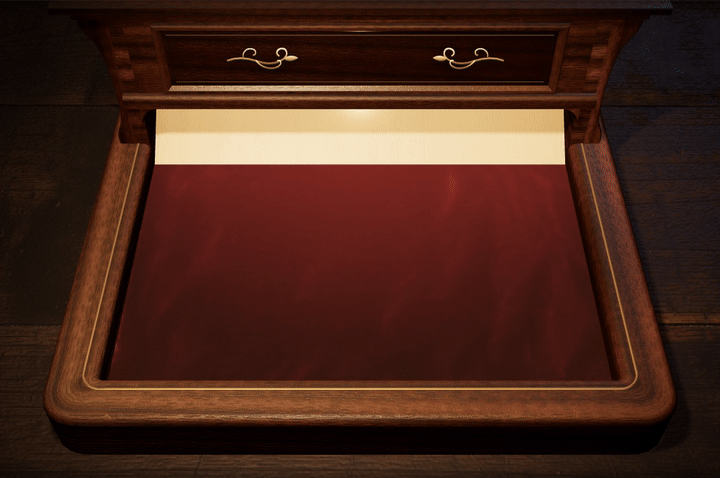
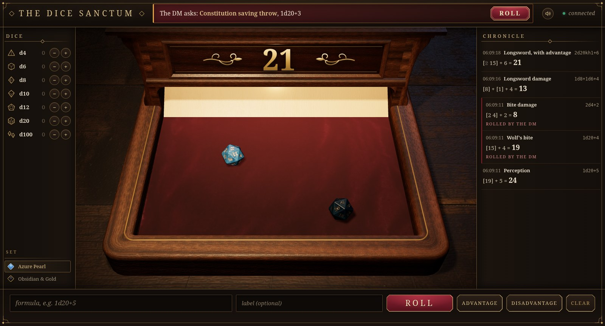
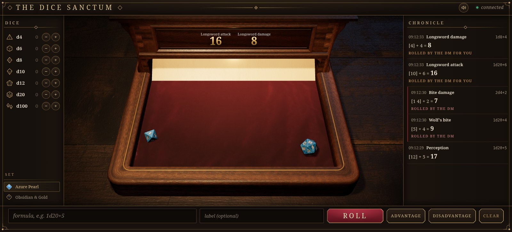

# The Dice Sanctum

A 3D dice table with real physics, made for playing tabletop role-playing games with Claude Code as the game master.

You roll in your browser, in a walnut dice tower: the dice tumble down the chutes, come out of the arch and roll on the velvet, and you hear every hit. As soon as they stop, the roll reaches the DM's Claude Code session through a small local bridge and an MCP server. The DM can also ask you for a roll: a notice appears on the table with its own ROLL button, and the result comes back inside the same tool call. The DM's own dice (monsters, companions) land on the same tray, in a set of their own, where you watch them stop. And when you cannot be at the table, you can tell the DM to roll for you: your own dice roll all the same, and the log keeps the roll as yours.





*In italiano: [README.it.md](README.it.md)*

## How it works

Three pieces, all on your machine:

- **the table**: a web page (three.js for the scene, Rapier for the physics) open in a browser window;
- **the bridge**: a Node process on `127.0.0.1:4777` that serves the page, talks to the table, writes the roll log and answers the MCP server;
- **the MCP server** `dice-sanctum`: six tools for the DM, and a channel that pushes your rolls into the session.

Every result comes from the physics: the dice drop into the tower with a random spin and speed, tumble from one chute to the next, roll out of the arch into the court, and the value is read from the face that ends up on top. The bridge checks every roll it receives (formula, dice values, kept dice, total) before it writes it down.

The DM's dice are thrown by the bridge, with the same physics and the same source of randomness, in a tray of its own. The bridge reads the faces, writes the roll in the log and sends the table a recording of the throw: the table plays it back with the DM's dice, and they stop on the faces the log holds. The rolls the DM makes in your place are thrown the same way, and played back with your dice.

## Requirements

- Node.js 24 or newer
- a browser with WebGL 2 (developed on Chromium; Firefox and Safari should work and are still to be tried)
- Claude Code, for the DM side (the table also works on its own)

Developed and tested on Linux. The start script, the bridge and the MCP server are written to run on macOS and Windows as well; nobody has tried them there yet, and reports are welcome.

## Quick start

### As a Claude Code plugin

In a Claude Code session:

```
/plugin install dice-sanctum --marketplace andreainandri/dice-sanctum
```

This needs Claude Code 2.1.275 or later. On an older version it takes two steps: `/plugin marketplace add andreainandri/dice-sanctum`, then `/plugin install dice-sanctum@dice-sanctum`.

The plugin brings the MCP server, the roll channel and two skills in one install. The install asks for the player's name, the one the DM reads in the results ("Ada rolled r-0007: …"); left empty, the texts say "the player". Claude Code installs the plugin's Node dependencies.

Then ask Claude to open the dice table, or type `/dice-sanctum:table`: it starts the bridge, builds the page the first time and opens the table in your default browser. `/dice-sanctum:dm` tells Claude how to run the game with the table, and Claude loads it by itself when the session is a game.

A bridge started this way stops when the Claude Code session ends. The rolls stay in the log, and the table opens again the same way.

### By hand, from source

```sh
git clone https://github.com/andreainandri/dice-sanctum.git
cd dice-sanctum
npm install
npm start
```

`npm start` builds the page when needed, starts the bridge in the foreground and opens the table in your default browser. Ctrl+C stops the bridge. When the bridge is already running, `npm start` only opens the table.

Then register the MCP server with Claude Code, once (the plugin already brings it):

```sh
claude mcp add dice-sanctum --scope user -e DICE_SANCTUM_PLAYER=YourName -- node /absolute/path/to/dice-sanctum/src/mcp/server.ts
```

`DICE_SANCTUM_PLAYER` is the name the DM reads in the results; without it, the texts say "the player". The server's instructions tell Claude to use it only in the DM session.

### Rolls in real time

Claude Code can receive your rolls the moment they land, even while the session is idle, through *channels*, a research preview. With the plugin, start the DM session with:

```sh
claude --dangerously-load-development-channels plugin:dice-sanctum@dice-sanctum --allowedTools=mcp__plugin_dice-sanctum_table
```

and with the server registered by hand:

```sh
claude --dangerously-load-development-channels server:dice-sanctum --allowedTools=mcp__dice-sanctum
```

At startup Claude Code warns about development channels: choose "I am using this for local development". From then on every roll enters the conversation as a message like `<channel source="dice-sanctum" seq="12" kind="free" total="25">Free roll by Ada: Perception 1d20+5: [20] +5 = 25 · NATURAL 20</channel>`, and the DM answers right away. `--allowedTools` lets the DM use the five tools without a permission prompt at every roll.

Tested with Claude Code 2.1.325 in the `server:` form. The `plugin:` form is the one the channels documentation gives for a plugin outside the approved list, and with this plugin it is still to be tried. Channels are a research preview: the flag may change in later versions.

Without channels, the DM still gets every roll it asks for, because `request_player_roll` returns the result. For your free rolls it can keep the Monitor tool on the roll log:

```sh
tail -n0 -F ~/.local/share/dice-sanctum/tiri.jsonl | grep --line-buffered '"type":"roll.completed"' | grep --line-buffered -v '"rolledBy":"dm"'
```

(the roll log lives elsewhere on macOS and Windows: see [Configuration](#configuration)), and call `get_rolls` with the last seq it saw whenever it re-arms the Monitor.

## At the table

- **The dice panel** on the left: a click on a die's name adds one, `+` and `−` change the count. The formula field follows the panel, and the panel follows the field.
- **The formula**: `1d20+5`, `2d20kh1+5`, `4d6kh3`, `8d6`, `1d100`, `2d6+1d4-1`. At most 30 physical dice per roll (a d100 counts as two). The label, optional, says what you are rolling.
- **ROLL**, **Enter** in the field or **Space** outside the fields: roll. **ADVANTAGE** and **DISADVANTAGE** roll two d20s and keep the higher or the lower, leaving the field as it is. **CLEAR** clears the table: the dice off the tray, the total off the plaque, the fields, and the chronicle. Only the page forgets: the roll log keeps every roll for the DM, and rolls still waiting to reach the bridge stay in the chronicle.
- **The result** on the tower's plaque, in gold numerals: a natural 20 brighter, with the die lighting up for a moment, and a natural 1 in red.
- **The chronicle** on the right: time, label, formula, dice (the discarded ones dimmed), total, and "asked by the DM" on the rolls of a request. It refills from the roll log every time the page opens, from the last CLEAR on.
- **The DM's notice** at the top: "The DM asks: **Constitution saving throw**, 1d20+3" with its own ROLL button, which rolls exactly that formula with that label. With several requests, the oldest sits on top.
- **The DM's dice**: when the DM rolls in the open, its dice, marbled oxblood with gold numbers, come out of the same tower and roll on your tray, with a line that says who is rolling what. When they stop, every roll shows on the plaque with its label and its total, and enters the chronicle marked "rolled by the DM". Your own roll is never interrupted: the DM's throw waits for your dice to stop and leaves you the time to read them. When the DM rolls behind the screen, you hear the dice, muffled, and the chronicle says only that it rolled, with no label, dice or total.
- **The dice sets**, at the bottom of the panel: Azure Pearl (clouded blue resin, silver numbers) and Obsidian & Gold. The choice stays from one visit to the next. The DM has one set and it cannot be picked: a glance tells whose roll it is.
- **Sound**: you hear every hit of the dice, different on velvet, on wood and die against die, and boxed-in while the dice are inside the tower. The button at the top right turns it off and on, and the choice stays. A browser lets a page play sound only after the first click or key press.
- **The connection status** at the top right. Rolls made while disconnected wait in a queue, kept in the browser's storage so they survive closing the window, and leave on their own as soon as the bridge answers, each one once.
- **Rolls the DM makes for you**, when you have told it you cannot be at the table: your own dice come out of the tower with a line that says "The DM rolls for you", the total goes on the plaque as for your own rolls, and the chronicle marks them "rolled by the DM for you".



The page speaks English or Italian, following the browser's language; `?lingua=en` or `?lingua=it` in the address picks one. It adapts to the window: below 900 pixels of width the dice and the choice of set move to a strip under the tray and the chronicle opens from a button; in tall, narrow windows the tower shows whole.

### Dice notation

| written | means |
|---|---|
| `NdS` | N dice with S sides: d4, d6, d8, d10, d12, d20, d100 (also `d%`) |
| `khN`, `klN` | keep the N highest or lowest of the group: `2d20kh1` is advantage |
| `dhN`, `dlN` | drop the N highest or lowest: `4d6dl1` |
| `+`, `-`, numbers | groups and constants add up or subtract: `1d8+1d6+3`, `1d20-1` |

A d100 is two d10s, tens and units, and 00 with 0 makes 100. A natural 20 or 1 counts when the formula keeps a single d20 in a group that adds up: `1d20+5` and `2d20kh1+5` yes, `2d20+3` no.

## For the DM

The same guidance, in short, is in the MCP server's instructions, which Claude Code puts in the session's context, and at length in the plugin's `/dice-sanctum:dm` skill.

| tool | arguments | answers |
|---|---|---|
| `get_status` | none | bridge on or off, tables connected, last seq, open requests (oldest first) |
| `get_rolls` | `since_seq?`, `limit?` (1 to 500) | the events after `since_seq`, one per line with its seq; without arguments the last 10 |
| `request_player_roll` | `formula`, `label`, `wait_seconds?` (0 to 110) | the roll, or "Waiting"; a clear error when no table is open or the bridge is off |
| `cancel_player_roll` | `requestId` | cancelled; if it was already rolled, the roll |
| `dm_roll` | `rolls` (1 to 8, each with `formula` and `label`), `secret?` | every roll with its seq, and where the throw landed: on the table, behind the screen, or with no table connected |
| `roll_for_player` | `rolls` (1 to 8, each with `formula` and `label`) | every roll with its seq, whether a table showed the throw, and the requests still open |

- **A roll of the character** (an attack, damage, a saving throw, a check the player sees): `request_player_roll` with `wait_seconds` up to 110. The call returns the roll: "Ada rolled r-0007: Constitution saving throw 1d20+3: [14] +3 = 17 (seq 42)." While it waits, the session is busy on that call, and what the player types in the chat stays queued until the call returns. To ask for a roll and keep narrating, use `wait_seconds` 0.
- **When the time runs out** before the roll, the answer is "Waiting: …". The request stays on the table, and the roll arrives through the channel when it lands.
- **Free rolls**, made with the normal controls, arrive through the channel as soon as the dice stop. Every roll reaches the DM once: a roll returned by a call stays out of the channel.
- **A free roll never fulfils a request**, even with the same formula. When the player wants to roll something else, the DM cancels with `cancel_player_roll` and asks again.
- **The DM's own dice** (monsters, companions, hidden checks): `dm_roll`. The rolls of one turn go in one call, attack and damage together: they land in a single throw of at most 30 dice, and each has its own line in the answer. In the open, the call returns when the dice have stopped on the player's table, a second or two later; with `secret: true`, or with no table open, it returns at once and says so.
- **`dm_roll` never rolls the player's dice and never fulfils a request.** The DM's rolls come back in their own call and stay out of the channel; `get_rolls` lists them with everything else.
- **When the player cannot be at the table** and tells the DM to roll for them: `roll_for_player`. The bridge throws the character's dice with the same physics, and each roll enters the log as a roll of the player with `"rolledBy":"dm"`. A connected table plays the throw back with the player's own dice, puts the total on the plaque where their rolls go, and marks the roll in the chronicle as rolled by the DM for them; with no table open the roll is made and logged all the same. These rolls come back in their own call and stay out of the channel, and they fulfil no request: an open one stays on the table until the DM cancels it. The DM uses this tool only on the player's word, for one roll or until the player is back.
- **Back at a table that was hidden meanwhile**, the player finds the last throw lying on the velvet with its total, and the rest in the chronicle: a throw that has waited more than 15 seconds to be shown is not played back.
- **After an interruption**, `get_rolls(since_seq)` returns everything that entered the roll log in the meantime.

Why 110 seconds: Claude Code moves an MCP call that lasts longer than 120 seconds to the background (`CLAUDE_CODE_MCP_AUTO_BACKGROUND_MS`). With 110 the answer always comes back into the conversation.

## Configuration

Environment variables, all optional:

| variable | read by | default |
|---|---|---|
| `DICE_SANCTUM_PORT` | the bridge, `npm start` | `4777` |
| `DICE_SANCTUM_ROLL_LOG` | the bridge | `tiri.jsonl` in the data folder |
| `DICE_SANCTUM_CLIENT_DIR` | the bridge | `dist/client` in the project |
| `DICE_SANCTUM_URL` | the MCP server | `http://127.0.0.1:4777` |
| `DICE_SANCTUM_PLAYER` | the MCP server | `the player` |

The data folder is `$XDG_DATA_HOME/dice-sanctum` (or `~/.local/share/dice-sanctum`) on Linux, `~/Library/Application Support/dice-sanctum` on macOS and `%APPDATA%\dice-sanctum` on Windows.

The roll log (*tiri* is Italian for rolls) is a JSONL file that only grows: one compact JSON line per event (`request.created`, `roll.completed`, `request.cancelled`, `dm.roll.completed`), each one on disk (fsync) before anyone sees it. A `roll.completed` that the DM made in the player's place carries `rolledBy: "dm"`, with the `throwId` of its throw and `shown`. Only the bridge assigns the `seq`. When it restarts, the bridge reads the file back and rebuilds the last seq, the rolls already seen and the open requests.

## Security

The bridge is meant for one person on one machine, and it has no tokens. What protects it:

- it listens on `127.0.0.1` only, and answers only to `Host: 127.0.0.1:PORT` or `localhost:PORT`, against DNS rebinding;
- the table's WebSocket accepts only the app's own origin; the feed of the MCP server accepts processes (which send no Origin) and the app's origin, and refuses web pages;
- the HTTP API requires `Content-Type: application/json` and refuses any other Origin and any body over 64 KB, so a web page open in your browser cannot create roll requests;
- at most 30 dice per roll; no `eval`, and nothing received ever runs as a command;
- the bridge recomputes every roll from the dice values and refuses what does not add up.

Any program running under your user account can still talk to the bridge: that is where the trust ends.

The DM's screen is made of cardboard. A secret roll never reaches the page, but the roll log holds it in full and `GET /api/eventi` returns it: the screen keeps you from seeing by accident, and whoever wants to look behind it can.

## Fairness

Fairness is exact before it is measured. At every throw the numbers are tied to the physics solid by one of its own symmetry rotations, drawn at random (60 for the d12 and d20, 24 for the d6 and d8, 12 for the d4, 10 for the d10): whichever face the engine may favour carries a random number, so every number comes up with the same probability.

The tests check that the code really does this: simulated throws with the same physics, the same source of randomness (`crypto.getRandomValues`) and the same face reading as the table, 20,000 dice per test, each kind alone and in groups of five, compared with a uniform distribution by a chi-square test. A test that comes out with p under 0.01 is run again by itself on five times the throws. No die shows any sign of bias; the lowest p-value across all the tests is 0.032. The full report, in Italian, is in [docs/equita.md](docs/equita.md), and `npm run fairness` runs it again.

Two biases were found and removed on the way. The first: Rapier builds the contact of a face with at most four points, so on the pentagons of the d12 one corner stayed out and the die came out unbalanced (p under 0.001 in two separate runs). The d12 is now built as a cube with six roofs, Euclid's construction, and the floor and walls of the tray are planes for the same reason. The second, smaller, only showed when counting 100,000 throws: the d12 still off by up to 3% (p 0.0004), because the solver handles the pieces of the collider in a fixed order. That is where the random symmetry comes from, and it applies to every die: counted again, p 0.71.

## Design notes

- **Gravity is the real one**, 981 cm/s², and the dice are large (the d6 is 19 mm): they fall and hit with their own weight. The tower is what makes a roll last, with four chutes before the arch: a single die comes to rest in 1.2 to 1.6 seconds, 0.7 of them inside the tower, and a full table of thirty dice in under 3.
- **The tower is as wide as the tray**, 30 cm, and so is its exit arch: the dice come out already spread. With a box tower in one corner and an 8.5 cm arch, thirty dice jammed in front of the exit and 94 rolls out of 100 failed.
- **Up to three rethrows per die.** A die that comes to rest tilted (more than 6° off a flat face), stays inside the tower, leaves the tray or keeps moving for 6 seconds goes back into the mouth of the tower. If it would need a fourth, the roll is cancelled and the table asks for a new one; the roll log never sees it. In the fairness tests it never happened: 800 full tables and 164,000 smaller throws.
- **6 and 9 are underlined** when they stand alone on a face.
- **Among kept dice with the same value, the first one rolled wins** (kh, kl, dh, dl).
- **The DM's dice are thrown by the bridge**, and the table shows a recording of the throw: the position of every die, sixty times a second. Throwing them again on the page from a seed would weigh less, but the smallest difference between Node and the browser would leave on the tray a face different from the number in the log.
- **The camera is fixed**, tilted 40° from the vertical, on the side of the person rolling, at the shortest distance that keeps in view the court and the front of the tower up to the plaque for the total. In wide windows the rest of the tower rises out of the frame; in tall, narrow ones it shows whole.
- **The total is page text** laid on the plaque: the scene tells the style sheet where the plaque falls on the canvas, at every window size.
- **The sound is synthesised**, with no recorded samples. The hits are derived from the motion of the dice (a sudden change of velocity beyond what gravity does), so they work the same for a throw simulated on the page and for the recording of a DM's throw. A compressor and a soft limiter on the output keep thirty dice below clipping.
- **The veins of the dice** come from a noise in space, read at the point of the die under each pixel of the face: they run from one face to the next without a break, as in a die that was really cast. The canvases are painted at startup, with no image files.
- **The textures** of walnut, velvet and table are photographs generated with FLUX (Black Forest Labs) and prepared for the scene: the baked light removed, relief and roughness extracted. Fonts and textures ship with the project, so the page works offline.

## Development

```sh
npm test            # 199 tests: notation, geometry, physics, recording, hits, events, bridge, DM dice, MCP server, plugin
npm run typecheck
npm run build       # the page into dist/client
npm run dev         # the page from source at 127.0.0.1:4778, without the bridge
npm run bridge      # the bridge in the foreground, without opening the browser
npm run fairness    # the fairness tests (a few minutes); rewrites docs/equita.md
```

The code is TypeScript that Node runs directly (type stripping), with comments in Italian. The sketch page `src/client/bozzetto.html`, served only by `npm run dev`, shows a still table from a fixed seed, for screenshots: for example `bozzetto.html?lingua=en&naturale=20`.

The integration tests start a bridge on a free port with a temporary roll log, use a test WebSocket in place of the browser and the MCP SDK client in place of Claude Code, and launch the real MCP server the way Claude Code launches it.

## License

MIT: see [LICENSE](LICENSE). The Noto Serif font (regular, bold and italic) is under the SIL Open Font License 1.1 (`src/client/caratteri/OFL.txt`). The textures were generated for this project and are released under the MIT license together with the code.

Designed by Andrea Inandri and written with Claude Code.
